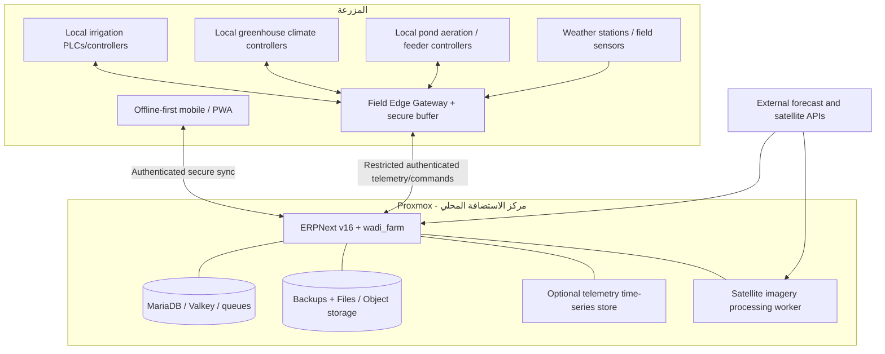

# البنية التقنية والنشر على Proxmox وتكامل الأجهزة
**WFM-ARC-0.3 | 2026-11-15**

## 1. الحدود المعمارية
`wadi_farm` هو **Frappe native application** داخل Bench الخاص بـ ERPNext v16، وليس مشروع SQL مستقل أو Fork من ERPNext. يضم DocTypes وPages/Workspaces وRole Permissions وController logic وBackground Jobs وServer APIs وFixtures وPatches واختبارات. يستفيد من مخزون ومحاسبة وشراء وبيع وأصول ERPNext مباشرة.

يجب فصل أربعة أنظمة منطقياً:
1. **ERPNext transactional**: بيانات الأعمال والدفاتر المالية وملخصات القياس والقرارات الرسمية.
2. **Offline field app/PWA**: تشغيل الموبايل داخل المزرعة دون اتصال ومزامنة مضمونة بعد الاتصال.
3. **Farm Edge Gateway**: الربط مع أجهزة الحقل ومخازن البيانات المؤقتة وبروتوكولات التشغيل الصناعية، مع قواعد تحكم آمن مستقلة.
4. **Data/Imagery subsystem**: قراءات حساسات كثيفة وخرائط/صور ضخمة ومعالجة أقمار صناعية؛ كخدمات اختيارية مرتبطة بالتطبيق.

## 2. مخطط مكونات مبدئي


## 3. Proxmox وERPNext
- يُنشأ تطبيق `wadi_farm` في Git repo منفصل ويُثبَّت ضمن Bench ERPNext v16، مع اختبار مسبق على بيئة staging منفصلة قبل الإنتاج.
- يمكن اختيار VM Debian/Ubuntu على Proxmox لتسهيل الفصل والتحديثات؛ LXC ممكن بعد تقييم متطلبات الاعتمادية والأمان ودعم النشر، ولا يُفترض مبدئياً.
- بيئة مستقلة لاختبار تحديثات ERPNext وFrappe على نسخة بيانات مخفية/منزوعة الأسرار قبل تنفيذها على الإنتاج.
- بنية الإنتاج تشمل reverse proxy/TLS، قاعدة بيانات، cache/queues/jobs، تخزين ملفات ومرفقات، صلاحيات سحب النسخ الاحتياطية دون إعادة تعريض الخدمة.
- الوصول الخارجي الآمن عبر VPN أو Zero Trust access/بوابة موثقة حسب سياسة الشبكة؛ لا فتح مباشر لقاعدة البيانات أو التحكم الصناعي على الإنترنت.
- لا نغير إعدادات شبكات Proxmox الحالية أو أي LXC/VM ID أو مجلدات NAS أو التخزين قبل جرد التصميم الفعلي والاعتماد؛ هذا المستند لا ينفذ تغييراً على البنية الحالية.
- موارد الأجهزة وRPO/RTO وعدد المستخدمين والأجهزة ومعدل قياس الحساسات والتخزين اليومي تحدد في التخطيط السعوي، لا تفترض أرقاماً.

**مراجع:** https://docs.frappe.io/framework/user/en/installation ؛ https://docs.frappe.io/framework/user/en/basics/apps ؛ https://docs.frappe.io/framework/user/en/python-api/hooks

## 4. Offline-first: التنفيذ المطلوب وليس مجرد واجهة ويب
- Frappe Desk وحده ليس كافياً للالتزام بحفظ كل سجلات العمال Offline؛ يلزم عميل مخصص (PWA أو تطبيق هاتف مع حزمة Offline) مرتبط بواجهات مصممة لذلك.
- تخزين محلي مشفر قدر الإمكان مع PIN/جهاز معتمد وسياسة مدة صلاحية الجلسة ومحو البيانات عند سحب صلاحيات الجهاز عند عودة الاتصال.
- يسبق العمل بدون إنترنت تنزيل الحد الأدنى من البيانات المصرح بها: المهام والأكواد والحقول والأحياء والأعلاف والمعدات والتحقق من نسخ القوائم.
- كل حدث ميداني يحصل على UUID ثابت؛ إرسال idempotent وإعادة المحاولة دون إعادة قيد مخزون أو عملية مالية.
- مسار `Local Draft → Pending Sync → Accepted/Rejected/Conflict`، مع واجهة واضحة بعدد السجلات غير المزامنة وصور لم تكتمل.
- إدارة تغيّر البيانات أثناء عدم الاتصال: تضارب تحرير نفس سجل، نفاد مخزون بعد تسجيل الصرف، حيوان انتقل لحظيرة مختلفة، أو حقل أُغلق؛ تعرض للمشرف للتسوية ولا تُفرض آخر نسخة تلقائياً على الوثيقة الرئيسية.
- لا يتم الاحتفاظ بأوامر تشغيل مضخة/تحكم مناخ/تهوية كأسلوب "Offline queue" تنفذ لاحقاً دون تقييم لحالة الجهاز في اللحظة المناسبة.

## 5. Integration Hub والأجهزة
### أ. نموذج الموصل (Adapter)
`Provider → Connector/Protocol → Raw Event → Validate/Normalize → Durable Event → Time-Series/Summary → Alert/Business Document`.

- موصلات: HTTPS/REST، MQTT، Modbus TCP/RTU عبر بوابة، OPC UA عند توفر واجهة صناعية، import CSV/JSON، Webhook عند سماح المزود.
- آلية polling/webhooks مع rate limits وdead-letter queue وretry backoff ومؤشر last_seen.
- لكل قناة: القياس ونوعه والوحدة والدقة والمجال المعقول والمرجع الزمني والمعايرة وقواعد جودة البيانات.
- منع تكرار الأحداث باستخدام External ID + Channel + Provider؛ وإذا لم يتوفر ID يُستخدم رقم مسلسل/توقيت/تجزئة مع سجل قرار dedup.
- تصحيح الوحدة/المعايرة لا يمحو القيمة الأصلية ولا الـ raw payload؛ حفظ revision لإعادة التحليل.
- إتاحة بوابات متعددة لمزارع مختلفة دون وصول بوابة إلى بيانات المزارع الأخرى.

### ب. قراءة مقابل تحكم
- الافتراضي **Read-only**؛ تغيير setpoint أو فتح valve يتطلب سياسة تحكم صريحة وصلاحية منفصلة.
- الأمر له رقم وتعليمات وتوقيع/هوية وإذن ووقت صلاحية؛ حالات `Requested, Approved, Sent, Acknowledged, Executed, Failed, Expired, Cancelled`.
- يجب اعتماد **local interlocks**، وحدود الأمان، والـmanual override، واختبار فقد الاتصال واختبار فشل الحساس قبل تمكين الأوامر.
- يحق لقواعد السلامة المحلية رفض الأمر حتى إن وافق ERPNext؛ تُسجل نتيجة الرفض مع السبب.
- شبكات OT منفصلة عن واجهة ERP والإدارة، وتُقيد الاتصالات بينهما؛ تطبيق مبادئ NIST SP 800-82.
- لا اعتماد على زمن استجابة ERPNext للتحكم اللحظي في oxygen/ventilation/pressure.

مرجع الأمن الصناعي: https://csrc.nist.gov/pubs/sp/800/82/r3/final

## 6. بيانات الأرصاد
- المصدر الأساسي عند توفره محطة فعلية قريبة، مع مصادر خارجية مخصصة للتنبؤ والتحقق والمقارنة لا بوصفها مرجعاً موضعياً معصوماً من الخطأ.
- مصادر مدعومة بالتكامل: محطات الطقس التابعة للمزرعة، APIs لطرف ثالث مثل Open-Meteo حسب الترخيص، ثم مزودون تجاريون/حكوميون حسب الاتفاق.
- حقول: Temp, RH, Rain, Wind Speed/Direction/Gusts, Solar Radiation, ETo, pressure, forecast issued_at and valid_at, coordinates, forecast model/version.
- الفرق بين measured / modeled / forecast أساسي، ويظهر في الواجهة وسجل التنبيهات والتوصيات.
- تطبيق قرارات الرش/الري يأخذ أحدث بيانات موثوقة وقد يتطلب إقرار المشرف، ولا يفترض أن تحديث API يعني بيانات محطة قياس في الحقل.

مرجع: https://open-meteo.com/en/docs

## 7. صور الأقمار الصناعية
- دعم رفع صور مصححة جغرافياً GeoTIFF/COG وملفات KML/GeoJSON وحدود الحقول مع حفظ CRS وMetadata وChecksum.
- أول موصل مقترح: Copernicus Data Space Ecosystem (STAC أو APIs المتاحة) للبحث عن مشاهد Sentinel-2؛ تضاف مصادر مدفوعة عندما يطلبها المستخدم.
- pipeline: catalog lookup → download/stream (حسب حقوق الوصول) → validation → cloud mask → reprojection/crop by field → optional indices (NDVI/NDMI) → maps & field observation.
- حفظ مصدر ووقت الالتقاط ووقت الجلب ودقة الصورة ونتيجة mask ونسبة السحب لكل طبقة. الصور الصغيرة لا تصلح لتحديد حالة نبات منفرد إن كانت الدقة المكانية غير كافية.
- لا تحفظ ملفات كبيرة في حقول نصية MariaDB، ولا تطبق crop بناءً على حدود مسح غير معتمدة؛ مقارنة الصور تتم باستخدام حدود متوافقة ونسخ معالجة محفوظة.
- ترخيص الصور وقواعد الاستخدام التجاري ومصاريف واجهة المزود تسجل في Provider Settings.

مراجع: https://documentation.dataspace.copernicus.eu/APIs/STAC.html ؛ https://dataspace.copernicus.eu/analyse/apis

## 8. أدوات القياس والتخزين
- بيانات مالية وتشغيلية أساسية في MariaDB عبر DocTypes معيارية.
- إن زادت قراءات الأجهزة (ثوانٍ أو دقائق على مئات القنوات) تحفظ raw/high-frequency في time-series subsystem منفصل مُرخّص للاستخدام، مع Derived Summaries وCritical Alerts في ERPNext.
- صور الأقمار/الفيديو/المخططات: مساحة تخزين كائنات/ملفات محمية، مع وصول مأذون/روابط صالحة زمنياً؛ سجلات metadata في Frappe.
- سياسة retention على مستويات: raw sensor، hourly/daily aggregate، document evidence، satellite scenes، backups؛ تحدد التزامات الاحتفاظ بدقة قبل الإنتاج.
- أدوات نسخ احتياطية تراعي تناسق قاعدة البيانات والمرفقات وتطبيق الاختبار على staging.

## 9. الأمان والهوية
- RBAC وUser Permissions حسب Company/Farm/Zone؛ الصلاحيات التخصصية لطلب شراء/اعتماد/تغيير مناخ/تحكم.
- تشفير الاتصال TLS، وحماية الأسرار، MFA للأدوار الحرجة، وسجل أوامر أجهزة حساس غير قابل للمحو بسهولة.
- عدم فتح Modbus/PLC/SCADA إلى الإنترنت أو تمرير رمز وصولها للهاتف.
- حماية محتوى الصور ومواقع العمليات والعاملين؛ حفظ الأذونات والأغراض التجارية والموافقات اللازمة.
- إمكانية تعليق بوابة/جهاز أو سحب صلاحية مستخدم ومراجعة كل العمليات التي حاول تنفيذها.

## 10. وحدات النظام البرمجية المقترحة
```text
wadi_farm/
  config/                 # Workspaces/roles/migrations
  farm_core/              # multi-farm, master data, GIS references
  crop_operations/        # seasons, crop operations, harvest
  water_irrigation/       # pump/tank/irrigation records
  livestock/              # animal, breeding, vet, feed
  greenhouses/            # climate zones, growth, recipes
  aquaculture/            # pond, fish cycle, feed, water quality
  equipment_maintenance/  # machinery and CMMS
  production/             # drying/packing/batch traceability
  risk_quality/           # safety, calibration, waste, claims, SOP
  field_operations/       # work order and offline sync API
  integrations/           # adapters, connectors, telemetry, commands
  geospatial/             # imagery metadata and indices
  finance_stock_bridge/   # ERPNext transaction integrations
  reports/                # dashboards and KPIs
  patches/                # migrations
  tests/                  # unit/integration/security
```
هذا تقسيم موضوعي؛ أسماء الملفات النهائية يجب أن توافق بنية Frappe المولدة قبل الإنشاء.

## 11. خطة النشر والتطوير
1. Proof-of-Compatibility على أحدث إصدار v16 المستهدف؛ تأكيد متطلبات Python/MariaDB/Node وأنواع المستندات/الامتدادات.
2. إنشاء Bench تجريبي وERPNext v16 وتطبيق `wadi_farm` بدون تعديلات Core.
3. تصميم Fixtures وPatch Registry ودليل إعداد الشركة والمزرعة والوحدات والمسؤولين.
4. اختبار العقود API وMock connectors للري/الطقس/التحكم قبل الاتصال الفعلي بالأجهزة.
5. تدريب عاملين على سيناريوهات Offline وإجراء انقطاع اتصالات متعمد واختبار تكرار التسجيل.
6. تجربة التحكم المباشر فقط بعد تقييم خطورة، وتوثيق PLC/vendor protocol وعزل OT.
7. نسخ احتياطي، اختبار استعادة، تحقق من التقارير والمخزون والتكلفة، ثم اعتماد إطلاق الإنتاج.

## 12. الاختبارات المطلوبة
- Unit: التحقق من قيود السجلات والحسابات والمساحات/التحويلات ودواء الحيوان.
- Integration: نقل مخزون، Batch Trace، ERPNext ledger، API Auth وRetry/Dedup.
- Offline: قطع شبكة يوم كامل، إعادة ترتيب الأحداث، تضارب هوية، صور كبيرة، فقد جزء من المرفقات، وتكرار push.
- OT/Fail-safe: انقطاع ERP أو البوابة والحساس والتغذية الكهربائية في بيئة اختبار غير إنتاجية، والتحقق من بقاء قواعد السلامة محلياً.
- Security: صلاحيات Company/Farm، أذونات التحكم، حماية ملفات صور الأقمار الصناعية والمرفقات، MFA.
- Performance: زيادات كبيرة في القراءات والصور والمستخدمين؛ قياس فعلي قبل إعلان سقف سعة.
- Upgrade: fresh install + migrate from old app release + restore + downgrade only عبر الاستعادة إن لزم.

## 13. ما ليس مطلوباً أن يحدث قبل بناء الإصدار الأول
- شراء PLC أو حساسات أو أجهزة جديدة؛ نُثبت interfaces وMocks أولاً.
- الاعتماد على شركة واحدة لإنترنت الأشياء أو صور الأقمار الصناعية.
- التحكم عن بعد في صوبة أو حوض سمكي دون تحقق سلامة محلي.
- تحديد أعداد ثابتة للحيوانات أو الصوب أو الأحواض.


## 14. الحد المنفذ حاليًا وقيود الإنتاج
- `public/mobile/` تطبيق ويب تجريبي PWA بتخزين IndexedDB وService Worker، يعمل دون إنترنت **بعد فتحه مرة متصلًا** وتحميل المزارع المصرّح بها.
- بيانات IndexedDB غير مشفرة من قِبل التطبيق؛ تحتاج سياسة أمان أجهزة ووضع إدارة الأجهزة/التشفير على مستوى نظام التشغيل قبل استعمال البيانات الحساسة ميدانيًا.
- API `wadi_farm.api.mobile.sync_batch` ينشئ `WFM Field Log` فقط بعد تحقق هوية المستخدم والربط الصريح `WFM User Farm Access`.
- أجهزة التحكّم لا تُشغل من ERPNext في هذا الإصدار؛ `WFM Device Command` للطلبات غير التنفيذية فقط.
- لا يوجد حتى الآن: SCADA فعلي، تكامل مدفوع مع قمر صناعي، محرك رستر، أو ترحيل مصروفات/مخزون أو تقارير محاسبية مكتملة.
- تحتاج الحزمة اختبار تثبيت وترقية **على Bench حقيقي بفروع Frappe/ERPNext v16**؛ لا تعد تجربة وحدات Python وحدها اعتمادًا إنتاجيًا.
