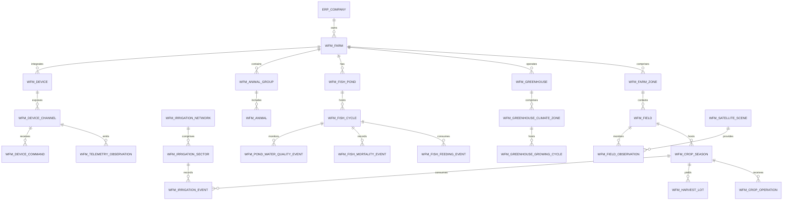

# تصميم قاعدة البيانات والعلاقات الأولي (Conceptual & Logical Data Model)
**WFM-DM-0.3 | 2026-11-15**

> أسماء DocType أدناه مقترحة، وليست ملفات تم إنشاؤها بعد. يتم تثبيت أسماء الحقول والتبعيات والمفاتيح في مرحلة ERD/Schema التفصيلية. كل الكيانات المقترحة خاصة بتطبيق `wadi_farm` إلا ما وصف صراحة بأنه من ERPNext.

## 1. نموذج المصدر الوحيد للحقيقة

| نوع البيانات | المرجع الرئيسي | قرار الربط |
|---|---|---|
| الشركة والحسابات والأصول | ERPNext: Company, Account, Cost Center, Asset, Journal Entry | رابط مرجعي/سلوك معتمد فقط |
| المواد والمخزون والدفعات | ERPNext: Item, Warehouse, Batch, Stock Entry, Serial and Batch Bundle | لا دفتر كميات موازٍ |
| الشراء والبيع والفواتير | ERPNext: Supplier, Customer, Purchase Order/Receipt/Invoice, Sales Order/Delivery Note/Invoice | مستندات ERPNext القياسية |
| الموظفون | ERPNext Employee أو HRMS حسب اعتماد التثبيت | عدم تكرار شخص عامل |
| الحقول والدورات والري والصوب والأحواض والماشية | Wadi Farm custom DocTypes | سجلات تخصصية مرتبطة بمالية ERPNext |
| القراءات الميدانية العالية التردد | مخزن قياسات مستقل اختياري مع summaries/alerts وروابط في Wadi Farm | منع تضخم معاملات ERPNext |
| الصور والخرائط والرستر الفضائي | مخزن ملفات/كائنات وصفي مع ميتاداتا ورابط Wadi Farm | لا تخزن أحجام GeoTIFF ضخمة داخل جدول DocType |
| العمليات الميدانية Offline | Local queue مرحلية على الجهاز؛ عند المزامنة يتحقق السيرفر وينشئ المستند الرسمي | لا اعتماد مالي قبل مزامنة ناجحة |

## 2. حقول إلزامية موحّدة

### السجلات المرجعية Master
`name/id`, `company`, `farm`, `code`, `display_name_ar`, `display_name_en`, `status`, `effective_from`, `effective_to`, `owner`, `created_by`, `modified`, `external_reference`, `attachments`.

### السجلات الحركية Transaction
`name/id`, `company`, `farm`, `activity_datetime_utc`, `display_timezone`, `business_date_local`, `site/zone`, `responsible_user`, `source_type`, `source_id`, `external_event_id`, `mobile_event_uuid`, `workflow_state`, `docstatus`, `linked_erpnext_doc`, `cost_center`, `operational_cost_object`, `notes`, `attachments`, `approved_by/at`.

### سجلات أجهزة / بيانات مستوردة
`device_id`, `channel_id`, `observation_at_utc`, `received_at_utc`, `value_raw`, `unit_raw`, `value_normalized`, `unit_normalized`, `quality_flag`, `source_name`, `source_record_id`, `mapping_version`, `calibration_status`, `signal_state`, `payload_hash`. مفتاح منع التكرار: `(device_id, channel_id, source_record_id)` إن توفر، وإلا سياسة dedup مبنية على القناة والتوقيت والرقم المتسلسل/التجزئة.

## 3. الهيكل الهرمي والموقع
| DocType مقترح | أهم الحقول | علاقات محورية |
|---|---|---|
| `WFM Farm` | company, code, location, timezone, area | شركة ERPNext؛ قطاعات ومرافق |
| `WFM Farm Zone` | farm, parent_zone, name, kind, area | قطاع ضمن مزرعة |
| `WFM Geo Feature` | feature_type, GeoJSON, CRS, effective period | حقول/أحواض/صوب/شبكات |
| `WFM Field` | zone, measured_area, soil_type, state | Geo Feature، Crop Season، Irrigation Sector |
| `WFM Facility` | type, zone, capacity, safety_class | حظيرة/تجفيف/مخزن/وحدة ضخ |
| `WFM Soil Sample` | field, date, depth, salinity, lab_result | حقل، مرفق تحليلي |
| `WFM Spatial Revision` | geo_feature, previous_revision, approval | حدود متغيرة زمنياً |

### قاعدة زمنية ضرورية
لا يعدّل النظام مساحة أو حدود حقل تاريخي بأثر رجعي: يسجل Spatial Revision بتاريخ سريان؛ كل موسم يحتفظ برابط نسخة الحدود والمساحة عند بدايته.

## 4. الزراعة والري
| DocType | البيانات الأساسية | العلاقات |
|---|---|---|
| `WFM Crop Variety` | crop/item, variety, supplier, agronomic metadata | كتالوج |
| `WFM Crop Season` | field, spatial_revision, variety, period, planned_yield | حقل/موسم/Cost Center |
| `WFM Crop Operation` | season, operation_type, date, labor, machine, applied_items | Farm Work Order؛ ERP Stock Entry |
| `WFM Crop Scouting` | season, geotag, symptom, image, recommendation | معاينات/إنذارات |
| `WFM Harvest Lot` | season, date, net_qty, moisture, quality | Batch ERPNext؛ Drying Batch |
| `WFM Water Source` | source_type, flow_capacity, salinity, location | خزانات ومضخات |
| `WFM Water Tank` | facility, total_capacity, working_capacity, level_sensor | Water Source؛ Water Balance |
| `WFM Irrigation Network` | type, geometry, source, pressure_design | Valve/Pump/Sector |
| `WFM Irrigation Component` | component_type, spec, asset, location | valves, filters, pumps, emitters |
| `WFM Irrigation Sector` | network, associated_field, design_flow | Field، Irrigation Program |
| `WFM Irrigation Program` | season, sector, targets, schedule | Irrigation Event |
| `WFM Irrigation Event` | program, start/end, meter before/after, source, volume | Crop Season، Device Command |
| `WFM Water Balance` | date/window, supply, demand, reserve, scenario | tanks/sources/sectors |
| `WFM Fertigation Event` | water_event, dose, feed_stock_entry | irrigation + materials |

## 5. الثروة الحيوانية البرية
| DocType | البيانات الأساسية | العلاقات |
|---|---|---|
| `WFM Animal` | UID/ear_tag, species, breed, sex, DOB, acquisition, current_group | واحد لكل فرد مميز |
| `WFM Animal Group` | kind, farm, location, state | حظيرة/دفعة تسمين |
| `WFM Animal Movement` | animal/group, from, to, date, reason | تاريخ موقع/ملكية |
| `WFM Animal Weight Event` | animal/group, measured_weight, date, source | معدل نمو |
| `WFM Breeding Event` | animal, mating/insemination, sire, pregnancy, offspring | تناسل |
| `WFM Birth Event` | dam, offspring_id(s), date, outcome | تعريف مولود/توائم |
| `WFM Animal Health Event` | diagnosis, vaccine, medication, dose, withdrawal_end | حجر وصرف أدوية |
| `WFM Feed Ration` | species, purpose, ingredients, version, stage | وصفة معتمدة |
| `WFM Livestock Feeding Event` | group, ration, planned/actual kg, date | ERP Stock Entry |
| `WFM Milk Production Event` | animal/group, qty, fat/protein if measured | دفعات إنتاج |
| `WFM Animal Exit Event` | sale/mortality/cull, animal, reason, linked_doc | بيع/نفوق/استبعاد |

**قيد:** لا يكون للحيوان الواحد مجموعتان فعالتان في نفس اللحظة؛ كل علاج ذي فترة سحب يجب أن يوقف إجراءات بيع/ذبح أو منتجات ذات صلة وفق سياسة الطبيب البيطري.

## 6. الصوب والتحكم المناخي
| DocType | البيانات الأساسية | العلاقات |
|---|---|---|
| `WFM Greenhouse` | farm, zone, geometry, cover, production_type | Facility وAsset |
| `WFM Greenhouse Climate Zone` | greenhouse, name, area, climate_system | أجهزة وموسم |
| `WFM Greenhouse Growing Cycle` | greenhouse_zone, crop_variety, start/end, growing_medium | Crop Season/Harvest Lot |
| `WFM Climate Recipe` | species, stage, day/night values, approved_revision | Target Schedule |
| `WFM Climate Target Schedule` | greenhouse_zone, recipe, valid_period | جهاز محلي / اقتراح |
| `WFM Greenhouse Actuator` | zone, device_channel, actuator_type, safe_state | أمر تحكم |
| `WFM Fertigation Recipe` | medium, nutrients, EC/pH targets, stages | Irrigation/Fertigation Event |
| `WFM Greenhouse Inspection` | zone, pests, controls, notes | Work Orders |

## 7. الاستزراع السمكي والأعلاف
| DocType | البيانات الأساسية | العلاقات |
|---|---|---|
| `WFM Aquaculture Unit` | system_type (pond/RAS/etc), site, common water circuit | Facility |
| `WFM Fish Pond` | unit, geometry, volume, depth, aeration/filtration, max design load | وحدة سمكية |
| `WFM Fish Species` | name, strain, environment needs, stage definitions | كتالوج ومؤشرات |
| `WFM Fish Cycle` | pond, species, start/end, economic center | دورة سمكية |
| `WFM Fish Stocking Batch` | cycle, source, count, initial_biomass, grade | Batch (عند ما يلزم) |
| `WFM Fish Population Movement` | source_batch, target_batch/pond, count, mass, date | نقل/فرز/دمج، منع ازدواج |
| `WFM Fish Sampling Event` | cycle, sample_size, weights, count_assumption, method | Biomass Estimate |
| `WFM Fish Biomass Estimate` | cycle, date, estimated_count/mass, method, confidence | حساب FCR والكثافة |
| `WFM Fish Mortality Event` | cycle, count, sample, reason, disposal_link | نفوق وتكلفة |
| `WFM Fish Health Event` | cycle, diagnosis, lab, treatment, withdrawal | مراقبة وحظر بيع |
| `WFM Fish Feed Plan` | cycle, feed_item, daily schedule, feed_rate_basis | أكل مخطط |
| `WFM Fish Feeding Event` | cycle, timestamp, feed_item/batch, qty_offered, qty_consumed, source | ERP Stock Entry |
| `WFM Pond Water Quality Event` | pond, sensor/manual/lab, DO, temp, pH, TAN, nitrite, etc | قياسات/تنبيهات |
| `WFM Aquaculture Harvest` | cycle, weight, graded_qty, buyer, quality | ERP Stock/Batch/Sales |

**مؤشرات:** FCR = كتلة علف مستهلكة ÷ زيادة كتلة حيوية مقدرة ومصححة للنقل والحصاد والنفوق، مع التنبيه لاختلاف التعاريف المحاسبية والعلمية حسب الهدف. تحفظ كل افتراضات التقدير، ولا يوضع FCR قاطع دون جرد معقول.

## 8. المعدات والصيانة والمرافق
| DocType | البيانات الأساسية | العلاقات |
|---|---|---|
| `WFM Machinery Profile` | Asset, serial, spec, owner, machine_class | ERPNext Asset |
| `WFM Machine Usage` | machine, job, hourmeter, fuel, operator | تكلفة أمر العمل |
| `WFM Fuel Issue` | tank, machine, meter, operator, qty, discrepancy | Stock Entry/Cost Center |
| `WFM Maintenance Incident` | subject_asset, severity, problem, safety_hold | Maintenance Work Order |
| `WFM Maintenance Work Order` | incident/plan, labor, parts, inspections, downtime | Asset Maintenance/Repair عند الملاءمة |
| `WFM Maintenance Plan` | interval/date/hourmeter, checklist, responsible | الأصول والأجهزة |
| `WFM Calibration Record` | device/instrument, standard, calibration date, due_date, pass | صحة القيم |
| `WFM Energy Meter Event` | meter/device, kWh, source, time | Energy Source |
| `WFM Power Source` | grid/solar/generator, capacity, fuel | Plant/Facility |

## 9. تشغيل يومي وجودة ومخاطر وأقسام إدارية
| DocType | البيانات الأساسية | العلاقات |
|---|---|---|
| `WFM Farm Work Order` | operation, location, assignee, planned/actual resources, state | Field/Pond/Greenhouse/Asset |
| `WFM Field Visit` | area, supervisor, findings, images, follow-ups | Tasks/Maintenance/Scouting |
| `WFM Lab Sample` | specimen, source, requested_test, lab, chain_of_custody | Soil/Water/Animal/Pond |
| `WFM Inspection` | checklist_version, assignee, evidence, pass/fail | Quality/Work Order |
| `WFM Nonconformity` | origin, severity, risk, corrective_action, verified | Incident/Recall |
| `WFM SOP` | category, version, revision, training_required | Inspections/Jobs |
| `WFM Training Acknowledgment` | employee, SOP_version, date, signature | HRMS or Employee |
| `WFM Risk Register` | hazard, likelihood, impact, owner, mitigation, due | Incident |
| `WFM Emergency Incident` | hazard_type, response_plan, escalation, event log | Facility/Device |
| `WFM Insurance Policy` | covered_assets/crops/animals, policy_no, expiry | Claims |
| `WFM Insurance Claim` | incident, docs, amount, state, settlement | Accounts references |
| `WFM Waste Transfer` | category, qty, method, contractor, proof | Inventory/Disposal |
| `WFM Visitor Entry` | visitor, company, purpose, host, checkin/checkout, zones | Biosecurity |
| `WFM Traceability Case` | lot/batch, reason, affected_qty, customers, actions | ERPNext Batch/Delivery |
| `WFM Farm Document Register` | type, related_entity, expiry, revision | ERPNext File |
| `WFM Cost Allocation Rule` | allocation_basis, period, cost_object, revision | ERPNext GL/Cost Center |

## 10. أجهزة المزرعة والتكامل
| DocType | البيانات الأساسية | العلاقات |
|---|---|---|
| `WFM Integration Provider` | name, integration_kind, API/driver, active, contract/license | External Connection |
| `WFM Integration Connection` | provider, auth_reference (no plaintext), polling/sync mode, scope | Device Registry |
| `WFM Device` | model, protocol, gateway, serial, physical_location, class | Asset/Zone/Pond |
| `WFM Device Channel` | device, metric/actuator, raw_unit, normalized_unit, calibration, limit | Telemetry/Command |
| `WFM Telemetry Observation` | channel, observed/received time, raw/normalized, quality, source_event_id | Alert; may be summarized to ERPNext |
| `WFM Device Alarm` | channel, condition, priority, acknowledged_at, cleared_at | Incident/Work Order |
| `WFM Control Policy` | channel, allowed_roles, safe_limits, approvals, override_mode | Commands |
| `WFM Device Command` | policy, target, command, requested_by, approval, ack, execution, result | Device gateway |
| `WFM Sync Job` | provider, cursor, checkpoints, errors, retry_count | Connector diagnostics |
| `WFM External Mapping` | source_key, target_channel, conversion, revision | Validation |
| `WFM Edge Gateway` | farm, network_zone, status, last_seen, certificate_ref | Devices |

**مهم:** تصاريح إرسال الأوامر والتحكم منفصلة عن حق قراءة البيانات. لا ينقل البرنامج حماية المحركات/المضخات أو أنظمة التهوية من المتحكم المحلي إلى ERPNext.

## 11. الأقمار الصناعية والمساحة
| DocType | البيانات الأساسية | العلاقات |
|---|---|---|
| `WFM Imagery Provider` | name, license, price policy, available datasets | Integration Provider |
| `WFM Satellite Scene` | provider, scene_id, sensor, collection, time_utc, cloud, CRS, resolution, storage_ref | Geo Feature |
| `WFM Raster Layer` | scene, index_type, processing_revision, style, object_path | Field GIS |
| `WFM Field Observation` | field, scene, index_value, area_overlap, reliability, flagged_area | Crop Scouting |
| `WFM Satellite Review` | field, observation, reviewer, finding, followup_job | Field Visit |
| `WFM Image Processing Job` | scene, product, cloud_mask_method, status, errors | Data processing |

تشمل المنصة رفع صور مقدمة من المستخدم وموصلات Copernicus وغيرها، مع حفظ الترخيص وحق الاستخدام، وتخزين الملفات الكبيرة ككائنات أو ملفات خارج جدول DocTypes.

## 12. مخطط العلاقات المبسط (Mermaid ERD)

## 13. نقطة الربط المحاسبي والتكلفة
- نستخدم **ERPNext Warehouse + Item + Batch + Stock Entry + Purchase/Sales transactions** كطبقة الحركة الرسمية.
- المستند الزراعي يحمل `linked_stock_entry` أو قائمة روابط بنموذج Join عند تعدد حركات المخزون، ولا يزيد رصيد المخزون بنفسه.
- تخصيص كلفة الحقل أو القطيع أو الحوض عبر Cost Center أو Dimension/Cost Object مناسب بعد مراجعة محاسب ERPNext؛ لا تنشأ Cost Centers عمياء لكل حيوان إذا كانت غير عملية.
- لا تُسجل المعاملة في دفترين. عند تأخر الاتصال، يبقى العمل الميداني **Pending Sync/Validation** ولا يوصف بأنه مخزون مصروف فعلياً حتى يقبل السيرفر المعاملة.
- معاملات التجميع/التفريق للسمك أو انتقال القطيع تحفظ Ledger تشغيلياً للأعداد، مع مطابقة محاسبية دورية.
- تصحيح بيانات المصدر بعد الاعتماد يتم بسجل تعديل/عكس واضح؛ قراءات الحساسات الأصلية تحفظ مع نتيجة المعالجة لا تستبدل بصمت.

## 14. هيكل أسماء IDs مقترح
- مزرعة `FARM-0001`، حقل `FLD-000001`، موسم `CRS-YYYY-00001`.
- صوبة `GHS-00001`، منطقة مناخ `GHZ-00001`.
- حوض `POND-00001`، دورة سمكية `FISH-YYYY-00001`، دفعة تخزين `STK-00001`.
- حيوان `ANM-0000001` مع رقم أذن خارجي منفصل، وجهاز `DEV-00001`.
- المستندات التقنية `CMD-000001`, `OBS-00000001`, `WKO-000001`.

## 15. ما يلزم إكماله قبل كتابة DocTypes
لكل كيان: جدول حقول، نوع الحقل، Required/Default، Unique، Link، Indexes، Permissions، Controller Rules، Workflow، Fixtures، Reports، Test Cases، وسياسة أرشفة ونسخ.

## 16. نموذج الطيور والدواجن — v0.4
| DocType | الاستخدام |
|---|---|
| `WFM Bird Species` / `WFM Bird Breed` | كتالوج الأنواع والسلالات |
| `WFM Bird House` / `WFM Bird Flock` | العنابر والأبراج والمجموعات والدورات |
| `WFM Bird` / `WFM Bird Pair` | هوية الفرد وأزواج الحمام والتربية |
| `WFM Bird Nest` / `WFM Bird Clutch` / `WFM Bird Incubation` | الأعشاش والبيض والتفريخ |
| `WFM Egg Collection` | إنتاج البيض وفرزه |
| `WFM Bird Feed Event` / `WFM Bird Weight` | الأعلاف والأوزان وقياس النمو |
| `WFM Bird Health` / `WFM Bird Mortality` | الصحة والنفوق وفترات سحب العلاج |
| `WFM Bird Transfer` / `WFM Bird Environment` | الحركة والمراقبة المناخية |
| `WFM Bird Production` / `WFM Bird Harvest` | الإنتاج والحصاد وربط ERPNext |
| `WFM User Farm Access` | تحديد المستخدمين المخولين بالوصول لكل مزرعة في API الميداني |

### متطلبات تكامل وأرصدة مستقبلية
يجب إنشاء سجل `Bird Population Ledger` مُعتمد يحسب: عدد بداية الفترة + وارد + فقس + نقل وارد - نقل صادر - نفوق - بيع - استبعاد = عدد النهاية. التتبع الفردي والجماعي يجب أن يُسوى دون ازدواج. DocTypes الحالية تحفظ مدخلات أولية فقط **ولا تحسب جردًا محاسبيًا ملزمًا بعد**.
